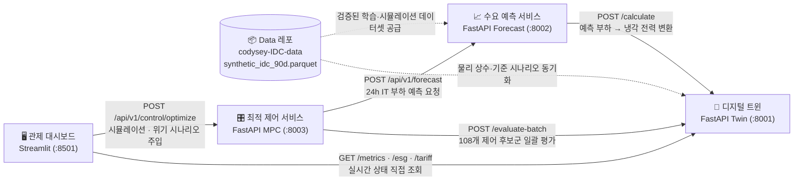
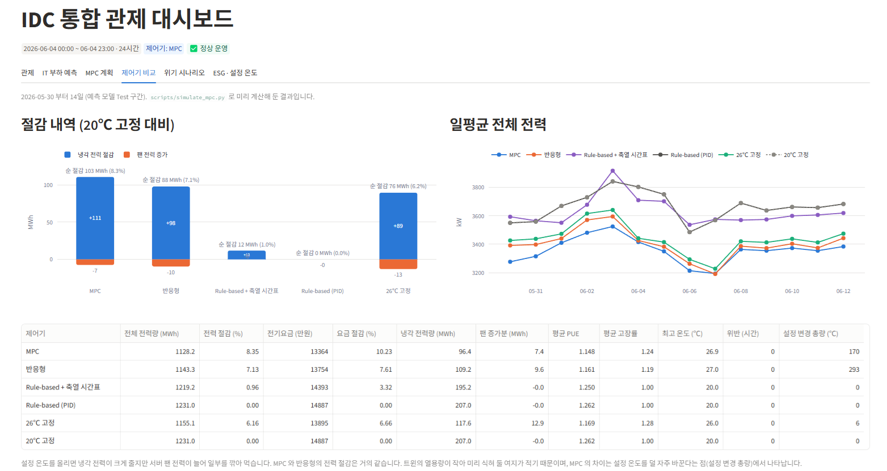
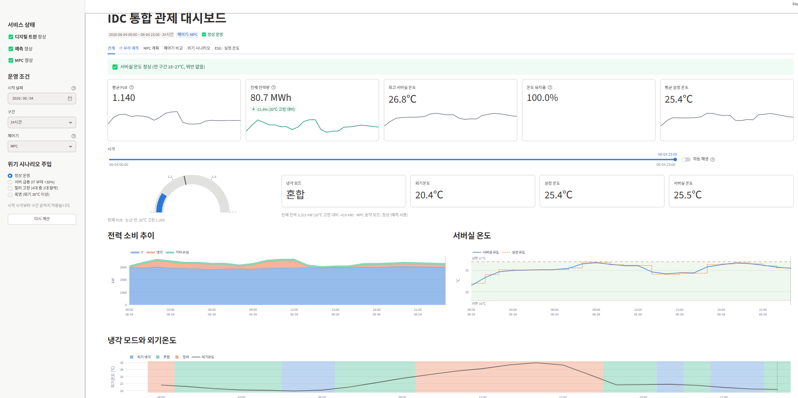
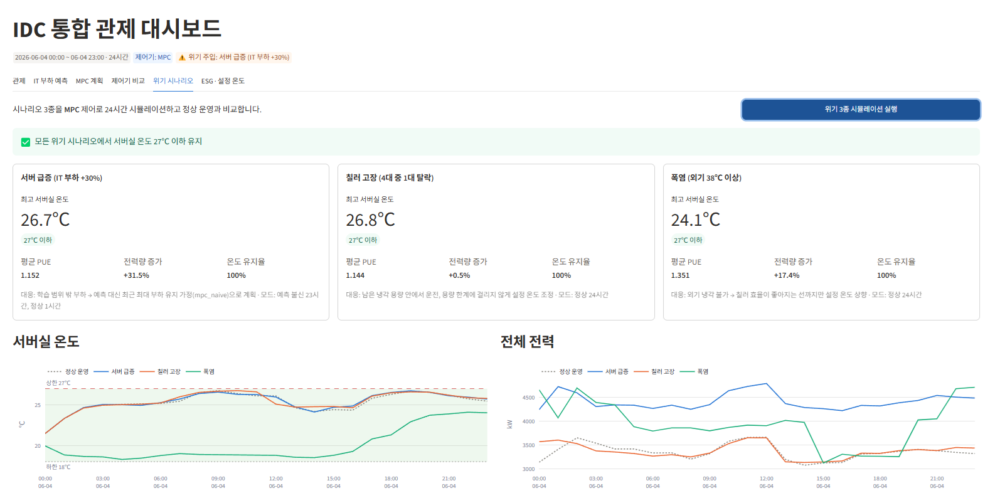
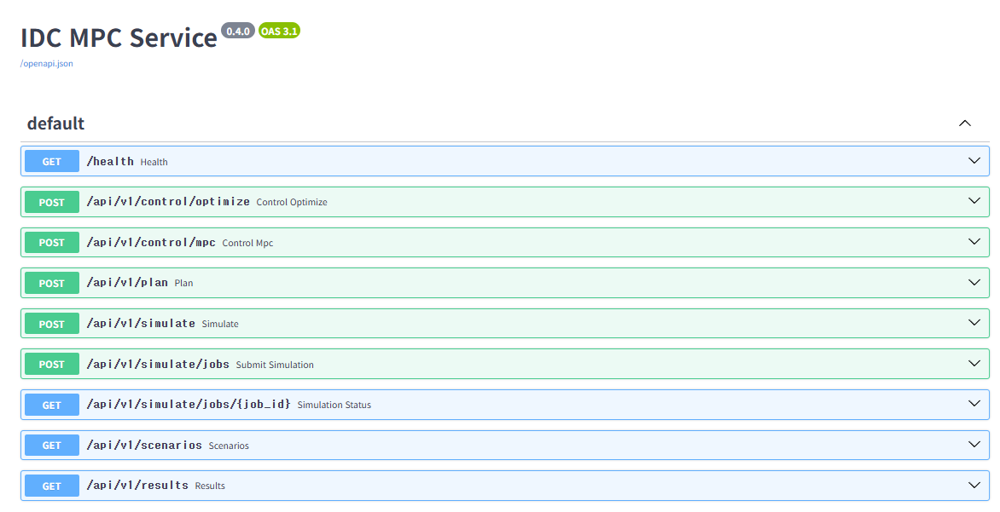

# 🌿 AI Green IDC: 데이터센터 지능형 냉각·전력 최적화 시스템


> **코디세이 AI 응용 프로젝트 (Team 1234 · `@codesey-IDC`)**  
> 열역학 모델로 구축·검증한 가상 IDC 운영 데이터셋(`codysey-IDC-data`)을 기반으로, 디지털 트윈 위에서 시계열 IT 부하를 예측하고 모델 예측 제어(MPC)를 통해 서버 설정 온도와 냉수 축열조(TES)를 최적으로 스케줄링하여 **데이터센터 전력 요금과 PUE를 동시에 절감하는 마이크로서비스 기반 지능형 관제 시스템(`ai-green-idc-back`)** 입니다.

---

## 📌 1. 프로젝트 개요 및 핵심 성과

데이터센터 전체 전력의 약 40% 이상이 냉각 설비에 소모됩니다. 기존의 고정 설정값 기반 `Rule + PID` 제어는 부하와 외기 온도 변화에 사후적으로 반응하여 불필요한 과냉각 전력을 낭비하고, 폭염이나 트래픽 급증 시 서버 과열(27℃ 초과) 위험에 노출됩니다.

**AI Green IDC**는 **데이터 파이프라인 검증 레포**와 **4개의 독립 컨테이너 서비스(REST API 통신)로 구성된 폐루프(Closed-Loop) 최적화 레포**를 결합하여, 에너지 비용 절감과 운영 안정성을 동시에 달성했습니다.

### 🏆 주요 달성 지표 (요구사항 대비)
| 평가 항목 | 목표 기준 | 달성 결과 | 비고 |
| :--- | :---: | :---: | :--- |
| **열역학 모델 오차 (vs Sinergym)** | 10% 이내 | **냉각 전력 -1.5% / PUE -0.2%** | 1년치 EnergyPlus 시뮬레이션 비교 |
| **IT 부하 예측 MAPE (24h / 168h)** | 5% / 8% 이내 | **0.860% / 0.835%** | Ridge 회귀 모델 선정 |
| **90% 예측 구간 Coverage** | 85% 이상 | **90.0% ~ 91.0%** | 불확실성 정량화 충족 |
| **냉각 수요 예측 nMAE** | 10% 이내 | **0.99%** | Twin API 물리 변환 연동 |
| **MPC 전기요금 절감률 (vs Rule-based)** | 10% 이상 | **10.23% 절감** | Test 14일 폐루프 기준 (PUE `1.262 → 1.148`) |
| **3대 위기 시나리오 방어** | 27℃ 이하 유지 | **전 시나리오 27℃ 이하 유지** | 부하 +30%, 칠러 1대 고장, 폭염 38℃ |
| **단위 테스트 Coverage** | 60% 이상 | **91.3% (208개 통과)** | PEP 8 위반 0건, 전 함수 Type Hint 적용 |

---

## 🏗️ 2. 시스템 아키텍처 및 레포지토리 구조

모든 런타임 모듈은 직접 함수 호출 없이 **REST API(JSON)**로만 통신하며, 데이터 생성 및 서비스 운영에 쓰이는 모든 물리·제어 상수는 `config/settings.yaml`과 `DATA_SPEC.md`로 동기화하여 관리합니다.



### 📂 통합 레포지토리 및 디렉토리 구조

본 프로젝트는 **데이터 구축·검증 레포(`codysey-IDC-data`)**와 **서비스·관제 시스템 레포(`ai-green-idc-back`)** 두 축으로 구성됩니다.

#### 1) 서비스 및 관제 시스템 레포 (`ai-green-idc-back`)
```text
├── config/
│   └── settings.yaml              # 전체 물리 상수, 한전 요금표, MPC/PID 파라미터 중앙 설정
├── data/
│   ├── synthetic_idc_90d.parquet  # Data 레포에서 검증·확정된 메인 학습·시뮬레이션 데이터
│   └── external/                  # 한전 데이터센터 현황(kepco_datacenter_2023.json)
├── services/
│   ├── twin/                      # [Port 8001] 열역학(physics.py), 요금(tariff.py), ESG(esg.py)
│   ├── forecast/                  # [Port 8002] 피처 엔지니어링(features.py), Ridge/LightGBM 예측
│   └── mpc/                       # [Port 8003] MPC 최적화(controller.py), Rule-based, 위기 시나리오
├── dashboard/
│   └── app.py                     # [Port 8501] Streamlit 실시간 통합 관제 대시보드
├── scripts/                       # 모델 학습·비교, Sinergym 검증, 민감도 분석, API 벤치마크
├── docs/                          # API.md(API 명세), thermodynamics.md(수식), docker.md(실행 가이드)
├── tests/                         # 208개 단위·통합 테스트 (Coverage 91.3%)
├── docker-compose.yml
└── start.bat                      # Windows 원클릭 실행 스크립트
```

#### 2) 데이터 구축 및 검증 레포 (`codysey-IDC-data`)
```text
├── data/
│   ├── synthetic_idc_90d.parquet  # 열역학 모델 기반 90일(5분 단위, 25,920행) 최종 학습셋
│   └── external/
│       └── kepco_datacenter_2023.json  # 한전 실측 통계 (IDC 계약전력 Scale 검증용)
├── output/                        # 데이터 검증 리포트 및 중간 산출물 관리
├── clean_data.py                  # 결측치 선형 보간, 이상치 제거, 메모리 최적화(Downcasting)
├── finalize_data.py               # 이중 계산 오류 참조셋(2016 ASHRAE) 배제 및 최종셋 확정
├── inspect_files.py               # 데이터 스키마·컬럼 표준화 및 통계량 점검
├── compare_files.py               # 원본-정제본 간 무결성(행/열 오차 0%) 비교 검증
├── DATA_SPEC.md                   # 17개 변수 정의, 단위, 생성 공식 및 물리 상수 명세서
└── README.md                      # 데이터 파이프라인 개요 및 Sinergym·한전 검증 결과 요약
```

---

## 📊 3. 데이터 파이프라인 및 검증 (`codysey-IDC-data`)

실제 데이터센터 운영 데이터의 보안 제약을 극복하기 위해 **공개 워크로드·기상 데이터와 자체 열역학 모델을 결합**하여 물리적 완결성과 시장 현실성을 모두 확보했습니다.

1. **메인 학습 데이터셋 구축 (`data/synthetic_idc_90d.parquet`)**
   * **규모 및 포맷**: 90일 × 5분 단위 = **총 25,920행, 17개 변수** (`cpu_utilization`, `outdoor_temp_c`, `it_power_kw`, `cooling_power_kw`, `pue`, `cooling_mode` 등)를 고속 입출력에 유리한 Parquet 포맷으로 구축했습니다.
   * **원천 데이터 결합**: Google Cluster Trace 2019(서버 CPU 작업량 패턴) + 기상청 ASOS API(기온·습도·풍속 및 극한 폭염 데이터) + SPECpower_ssj2008 벤치마크 공식을 결합해 물리 법칙 기반 시계열을 생성했습니다.
2. **데이터 논리 검증 및 정제 (`clean_data.py`, `finalize_data.py`)**
   * 2016년 일반 건물 기반 참조 데이터(`cleaned_datacenter_structured.json`)는 건물 전체 전력에 이미 냉방 부하가 포함되어 있어 IDC 전용 PUE 산출 시 **이중 계산(Double Counting) 오류**가 발생함을 규명하고, 최종 학습셋에서 물리적으로 배제해 데이터 순수성을 보존했습니다.
   * `inspect_files.py` 및 `compare_files.py`를 통해 결측치 선형 보간, 음수 이상치 제거 후에도 원본 대비 행/열 무결성(오차 0%)을 검증했습니다.
3. **시장 현실성 검증 (`kepco_datacenter_2023.json` Scale Check)**
   * 한국전력공사 실측 통계(국내 IDC 평균 계약전력 **13.24MW**)와 대조하여, 본 시뮬레이터의 피크 IT 전력(**약 2.2MW**, 서버 10,000대 규모)이 국내 중소규모 IDC의 실제 부하 범위 내에 있음을 입증했습니다.

---

## ⚙️ 4. 핵심 모듈 상세 구현 (`ai-green-idc-back`)

### 4.1 디지털 트윈 (`services/twin/`, Port `8001`)
* **열역학 모델 (`physics.py`)**:
  * **IT 전력**: 서버 1만 대(SPECpower 기준) $P_{\text{IT}} = 2,150 + 3,600 \times u_{\text{cpu}}\ (\text{kW})$
  * **냉각 부하 및 효율**: $Q = \dot{m} \cdot c_p \cdot \Delta T$ ($\dot{m}=250\text{kg/s}$), 외기 온도에 따른 칠러 COP 감쇠 모델링
  * **냉각 모드 자동 전환**: 외기 $\le 15^\circ\text{C}$ **Free Cooling** / $15\sim18^\circ\text{C}$ **Hybrid** / $>18^\circ\text{C}$ **Chiller**
  * **물리적 제약 반영**: 설정 온도 상승 시 서버 팬 전력 증가, 고장률(x-factor) 가중, 냉각 정지 시 $32^\circ\text{C}$ 도달 버팀 시간(15분 이상) 및 **12,000kWh 냉수 축열조(TES)** 충·방전 동역학 구현
* **요금 및 ESG (`tariff.py`, `esg.py`)**: 한전 일반용(을) 고압A 선택Ⅲ(계절·시간대·주말·공휴일별 차등 단가) 및 탄소 배출계수(`0.459 tCO2/MWh`), 물 사용 효율(`WUE`) 실시간 산출

### 4.2 IT 부하 및 냉각 수요 예측 (`services/forecast/`, Port `8002`)
* 학습(`train_ridge.py`)과 서비스 추론(`features.py`)에서 동일한 피처 파이프라인을 공유하여 데이터 누수(Data Leakage)를 원천 차단했습니다.
* **모델 비교 검증 결과**:
  | 모델 | 24h MAPE | 168h MAPE | 90% 구간 Coverage | 선정 여부 |
  | :--- | :---: | :---: | :---: | :---: |
  | **Ridge Regression** | **0.860%** | **0.835%** | **90.0% ~ 91.0%** | **✅ 최종 선정** |
  | LightGBM | 1.12% | 1.24% | 88.5% | 예비 모델 지원 |
  | Persistence (1주 전 동일 시점) | 3.45% | 3.45% | - | 베이스라인 비교용 |

### 4.3 MPC 최적 제어 및 위기 대응 (`services/mpc/`, Port `8003`)
* **제어 메커니즘**: 매시간 향후 24시간 부하 예측값과 시간대별 전기 단가를 조회한 뒤, `scipy.optimize.differential_evolution`으로 **설정 온도 + 축열조 운전 계획 후보 108개**를 Twin API에 일괄 평가하여 최저 요금 계획을 도출하고 첫 1시간을 적용(Receding Horizon)합니다.
* **안전장치 (Fallback)**: 서버실 온도 제약($18\sim27^\circ\text{C}$) 및 변화율 제한($\pm 2^\circ\text{C}/\text{h}$)을 준수하며, 예측 범위 이탈 시 최근 최대 부하 보수적 가정, 통신 장애 시 기본값($20^\circ\text{C}$)으로 즉시 복귀합니다.
* **Test 14일 시뮬레이션 비교**:
  | 제어 전략 | Rule-based 대비 요금 절감률 | 평균 PUE | 특징 |
  | :--- | :---: | :---: | :--- |
  | **Rule-based (PID, 20℃ 고정)** | 기준 (0.00%) | 1.262 | 사후 대응 및 고정 시간표 축열조 운전 |
  | 26℃ 고정 제어 | 6.66% | 1.169 | 단순 상한 온도 유지 |
  | 반응형 최적 제어 (예측 미사용) | 7.61% | 1.161 | 현재 시점만 최적화 |
  | **MPC 최적 제어 (본 시스템)** | **10.23% 절감** | **1.148** | **심야 경부하 축열 + 외기냉방 선제 활용** |



### 4.4 통합 관제 대시보드 (`dashboard/app.py`, Port `8501`)
* 실시간 PUE 게이지, IT/냉각 전력 소비 추이, 서버실 온도 분포, 현재 냉각 모드(Free Cooling / Hybrid / Chiller)를 시각화합니다.
* **위기 시나리오 주입 버튼**을 통해 ① IT 부하 +30% 급증, ② 칠러 1대 고장, ③ 외기 38℃ 폭염 상황을 즉시 시뮬레이션하고, $27^\circ\text{C}$ 임계치 방어 여부와 경고 알림을 확인할 수 있습니다.

| 정상 운영 관제 화면 | 위기 시나리오(폭염/부하 급증) 방어 화면 |
| :---: | :---: |
|  |  |

---

## 🚀 5. 설치 및 실행 방법

### 사전 요구사항
* Docker 24.0+ 및 Docker Compose 2.0+ (CPU 환경에서 전체 시스템 동작)

### 실행 명령어
```bash
# 1. 서비스 및 관제 레포지토리 클론
git clone [https://github.com/codesey-IDC/ai-green-idc-back.git](https://github.com/codesey-IDC/ai-green-idc-back.git)
cd ai-green-idc-back

# (선택) 데이터 검증 및 파이프라인 확인 시 Data 레포 클론
# git clone [https://github.com/codesey-IDC/codysey-IDC-data.git](https://github.com/codesey-IDC/codysey-IDC-data.git)

# 2. 전체 서비스 빌드 및 실행 (Linux / macOS / WSL2)
docker compose up --build -d

# (Windows 환경의 경우 원클릭 배치 파일 실행 가능)
start.bat
```

### 서비스 접속 주소
| 서비스 | 포트 | 접속 URL / API 문서 (Swagger) |
| :--- | :---: | :--- |
| **통합 관제 대시보드 (Streamlit)** | `8501` | http://localhost:8501 |
| **디지털 트윈 API (Twin)** | `8001` | http://localhost:8001/docs |
| **부하·냉각 예측 API (Forecast)** | `8002` | http://localhost:8002/docs |
| **MPC 최적 제어 API (Control)** | `8003` | http://localhost:8003/docs |



---

## 📚 6. 상세 기술 문서 (`docs/` & `DATA_SPEC.md`)

* [`docs/thermodynamics.md`](docs/thermodynamics.md): 열역학 방정식, SPECpower 모델링, 칠러 COP 및 축열조 수식 명세
* [`docs/API.md`](docs/API.md): Twin, Forecast, MPC 서비스의 전체 REST API 엔드포인트 및 입출력 JSON 스키마
* [`docs/docker.md`](docs/docker.md): 컨테이너 네트워크 구성, 환경 변수 및 트러블슈팅 가이드
* `codysey-IDC-data/DATA_SPEC.md`: 학습 데이터셋 17개 변수 정의, 단위, 생성 공식 및 한전 Scale 검증 명세

---

## 👥 7. 팀원별 역할 및 기여 (Team 1234)

| 이름 | 담당 역할 | 주요 기여 내용 |
| :---: | :--- | :--- |
| **박수현** | **팀장 · 프로젝트 총괄 & 데이터 파이프라인 구축·최종 정제** | • 프로젝트 전체 일정·아키텍처 주도 및 통합 관리<br>• Google Cluster Trace·기상청 API·SPECpower 기반 `synthetic_idc_90d.parquet` 구축<br>• 이상치 제거·이중 계산 데이터 배제(`clean_data.py`, `finalize_data.py`) 및 데이터 최종 정제·무결성 검증 |
| **임태형** | **AI 수요 예측 모델링 & 관제 대시보드 개발** | • 시계열 피처 파이프라인(`features.py`) 설계 및 데이터 누수 방지 검증<br>• 열역학 모델(`physics.py`), 한전 요금제(`tariff.py`), ESG 모듈(`esg.py`) 구현 및 Sinergym 오차(-1.5%) 검증<br>• Streamlit 기반 실시간 관제 UI(`dashboard/app.py`), 위기 시나리오 주입 및 27℃ 경고 시각화 개발 |
| **김영우** | **디지털 트윈 구축 & MPC 최적 제어·위기 대응 설계** | • Ridge, LightGBM, Persistence 모델 비교 및 90% 신뢰구간 예측 API(`services/forecast/`) 구현<br>• 24시간 Receding Horizon 기반 MPC 컨트롤러(`controller.py`) 및 Rule-based PID 베이스라인 구현<br>• 3대 위기 시나리오(부하 +30%, 칠러 고장, 폭염 38℃) 방어 로직 및 민감도 분석 수행 |
| **채다현** | **외부 데이터 정제 · 프로젝트 기록 & 발표 자료 제작** | • 한국전력공사(`kepco_datacenter_2023.json`) 데이터 정제 및 국내 IDC 계약전력 규모(Scale) 검증 지원<br>• 팀 정기 회의록 작성 및 프로젝트 진행 히스토리 기록<br>• 프로젝트 중간 발표 및 기말 최종 발표 PPT 기획·제작 |

---

## 🎤 8. 발표 자료 (Presentation)

> 💡 `docs/presentation/` 폴더에 발표 자료(`.pdf` 또는 `.pptx`)를 업로드한 뒤 아래 링크 경로를 맞춰주시면 GitHub에서 바로 열람·다운로드할 수 있습니다.

| 구분 | 발표 일자 | 발표 자료 | 주요 발표 내용 |
| :--- | :---: | :---: | :--- |
| **중간 발표 (Midterm)** | 2026.10 | [📄 중간발표_AI_Green_IDC_Team1234.pdf](docs/presentation/midterm_presentation.pdf) | 문제 정의, 데이터 파이프라인 구축·최종 정제 결과, Sinergym 검증 및 초기 모델링 현황 |
